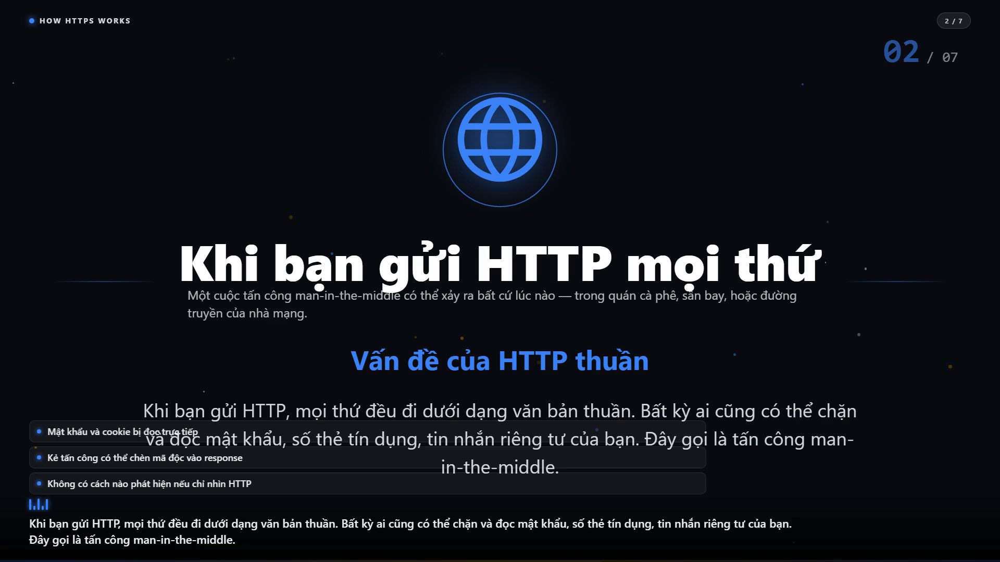
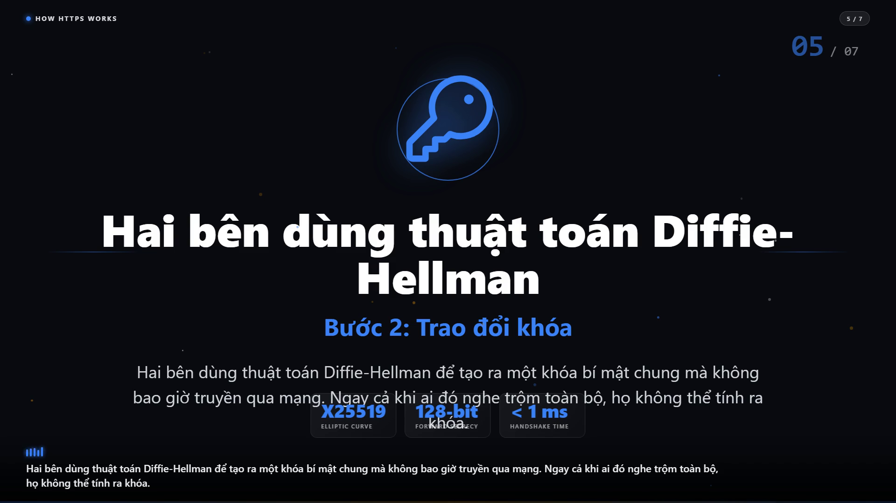
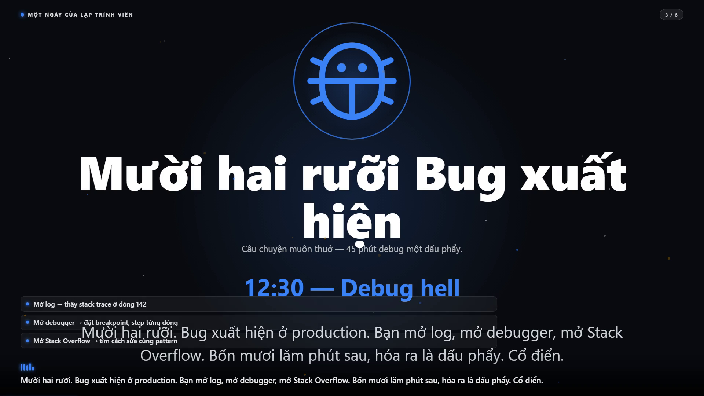
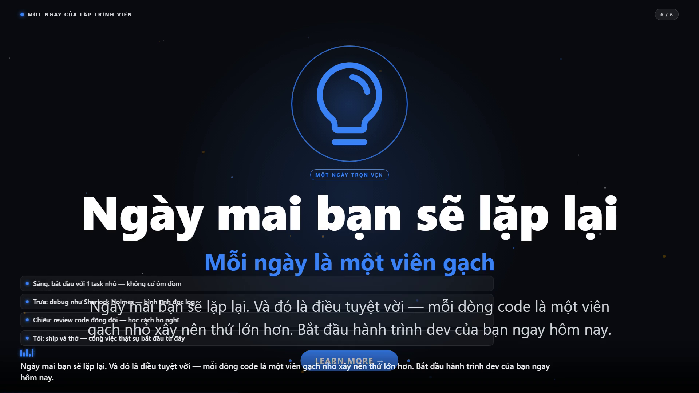
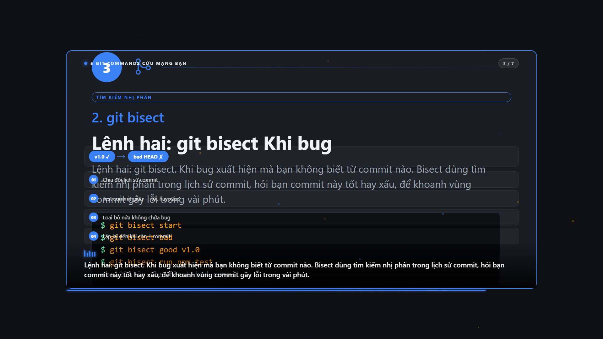
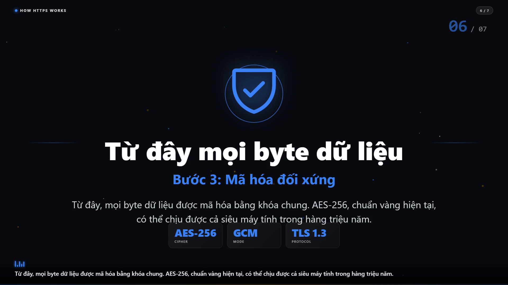

# fine-video-as-code

> **Video-as-Code pipeline** — turn a short topic into a polished explainer video in minutes.
> Web form → JSON input → 3-step backend workflow → `.mp4` file.
> **MIT-licensed throughout, including the rendering engine.**

---

## Overview

**fine-video-as-code** is an open-source pipeline for automated explainer-video generation. Fill in a short topic, pick a template, and the system produces a complete, voice-narrated video with synchronized visuals — no editing skills required.

**Three built-in templates:**

- 🎓 **Tech Explainer** — software architecture, code walkthroughs, technical concepts
- 📣 **Promo / Ad** — product videos, social ads, brand intros
- 📚 **Tutorial** — step-by-step guides, training, internal SOPs

Template names are normalised before validation: `tech`, `explainer`, `ad`, `howto`, `guide`, `sop`, `walkthrough` and a few other aliases are folded onto the canonical `tech-explainer` / `promo` / `tutorial` values (see `backend/lib/design-system.js`).

**The 3-step pipeline:**

1. **Scripting** — form data + LLM rewrite → `script.json`. (Or use a `presetScript` for curated scripts.)
2. **TTS** — Edge-TTS generates per-scene audio, pads each clip to its scene's `duration_ms` with `ffmpeg apad` → per-scene `mp3`.
3. **Render** — Playwright + headless Chromium opens an HTML template. By default the renderer is **deterministic** (`window.__seek` + per-frame screenshot → ffmpeg PNG stream → MP4); the realtime fallback (`recordVideo` webm) is opt-in via `DETERMINISTIC_RENDER=0`. ffmpeg-static muxes the audio track.

---

## Visual features

Each scene can carry up to one `visual_cues` entry, dispatched by `window.fineVideoEngine.renderCue()` inside `backend/templates/_engine.js`:

- **`icon`** — Phosphor SVG, 26 names vendored locally in `backend/templates/illustrations/icons.js` (e.g. `lock`, `key`, `git-branch`, `rocket`, `coffee`, `bug`, `certificate`, `shield-check`, `terminal`).
- **`image`** — inline SVG illustration from `backend/templates/illustrations/`. No external CDN, no copyright risk.
- **`chart`** — simple bar / pie / line chart in pure SVG, driven by a `data` array.
- **`decoration`** — code block, terminal mockup, stat card, scene-number badge, step number, particle background, fade-up entrance. Composable with any cue.

Per-template signature features:

- **Tech Explainer** — central icon hero + decorative code block + particles + scene-number badge.
- **Promo / Ad** — large icon hero + animated stat counter + CTA button.
- **Tutorial** — step-number badge + terminal mockup with real commands + progress visualization.

The same `_engine.js` powers all three — adding a new template = copy an existing HTML and tweak the layout. The shared cue vocabulary makes the templates look related without forcing them to be identical.

### Enrichment fields

Beyond the cue-based hero, every scene can carry optional enrichment fields in `script.json` (all rendered through the same `_engine.js`):

| Field         | What it adds                                                                    | Used in                                             |
| ------------- | ------------------------------------------------------------------------------- | --------------------------------------------------- |
| `badge`       | Uppercase pill above the heading ("● 5 LỆNH GIT", "● MỘT NGÀY TRÒN VẸN")        | samples 02, 03                                      |
| `subheading`  | Secondary line under the heading, brand color                                   | samples 01 (steps), 02, 03                          |
| `bullets`     | Short bullet list with bullet-marker, fade-up stagger                           | samples 01 (scene 2), 02 (scene 3, 6), 03 (scene 1) |
| `metrics`     | Row of value+label cards ("X25519 / ELLIPTIC CURVE", "< 1 ms / HANDSHAKE TIME") | samples 01 (scenes 5, 6), 02                        |
| `codeSnippet` | Terminal-style colored code block with traffic-light dots                       | sample 01 (scene 4), 02                             |
| `diagram`     | 2 nodes + numbered step boxes (binary-search visualization, etc.)               | sample 03 (scene 3)                                 |
| `visual_cue`  | Caption chip describing what the viewer is looking at                           | optional, any scene                                 |
| `layout`      | Layout variant: `title` \| `split` \| `stack` (auto-picked when omitted)        | optional, any scene                                 |

The HUD (`● TOPIC` top-left, large blue `02 / 07` scene indicator top-right) and the subtitle bar (equalizer icon + running voiceover text with a progress sweep) are auto-injected on every scene; they need no extra fields. A scene with no enrichment renders as before, so adding enrichment is non-breaking.

---

## Why this stack

The rendering stack is deliberately small and boring:

**Playwright + headless Chromium + vanilla HTML/CSS templates + Edge-TTS + ffmpeg-static**

- **Everything is MIT-friendly.** Playwright is Apache 2.0 (MIT-compatible), ffmpeg-static ships an LGPL open-source build, Edge-TTS is MIT, and the templates are plain HTML — the whole repo stays publishable under one permissive licence, with no per-render or per-seat licence fees.
- **No heavy bundler.** The templates are plain HTML + CSS + a small inline JS scheduler. There is no bundler, no transpiler and no build step between editing a template and rendering it — open `backend/templates/promo.html`, change a colour, re-render.
- **Fast renders.** Chromium does the actual work: the deterministic path screenshots one frame at a time and pipes the PNGs straight into ffmpeg, so the cost scales with the video length and the frames are bit-for-bit reproducible.
- **Easy to author.** A template is a 1920×1080 HTML file that a designer, an engineer or an LLM can edit with any text editor.
- **No vendor lock-in.** ffmpeg comes from `ffmpeg-static` (no system install), TTS comes from the Python `edge-tts` CLI (no API key, no account), and the browser comes from Playwright (one `npm run setup`).

---

## Requirements

| Requirement         | Version                   | Notes                                                                                                                                                                     |
| ------------------- | ------------------------- | ------------------------------------------------------------------------------------------------------------------------------------------------------------------------- |
| Node.js             | **≥ 20** (22 recommended) | The npm scripts load `.env` with `--env-file-if-exists`, which needs **Node ≥ 22.9**. On Node 20 start the server directly: `node backend/server.js`. CI runs on Node 22. |
| Python              | 3.9+                      | Only needed for the TTS step.                                                                                                                                             |
| Edge-TTS            | latest                    | `pip install edge-tts` — or `pipx install edge-tts` if you prefer isolated installs.                                                                                      |
| Playwright Chromium | bundled                   | Installed by `npm run setup` (~150 MB, one time).                                                                                                                         |
| `.env`              | —                         | **Optional.** The server runs without it; see [Environment variables](#environment-variables).                                                                            |

Edge-TTS is the only optional piece: without it the TTS step writes silent audio (`anullsrc`), the video still renders, and the job reports a `tts_failed:scene-N` warning.

---

## Quick start

```bash
git clone https://github.com/hpbaoan-source/fine-video-as-code.git
cd fine-video-as-code

npm install          # installs the JS dependencies (no browser download)
npm run setup        # verifies the toolchain + installs Playwright Chromium
pip install edge-tts # optional but recommended — the narration comes from here

npm start            # → http://localhost:3000
```

`npm run setup` prints exactly what is missing and how to fix it, then downloads Chromium (~150 MB, one time, cached afterwards).

**No `.env` file is required.** If you want one, copy the template and fill in what you need:

```bash
cp .env.example .env       # macOS / Linux
copy .env.example .env     # Windows
```

### Environment variables

All variables are optional — the defaults shown below are what the server uses when the variable is absent.

| Variable                | Default                     | Effect                                                                                                   |
| ----------------------- | --------------------------- | -------------------------------------------------------------------------------------------------------- |
| `PORT`                  | `3000`                      | Fastify listen port.                                                                                     |
| `LLM_API_KEY`           | —                           | If set, step 1 rewrites the scenes with an LLM. If unset, the template fallback is used.                 |
| `LLM_BASE_URL`          | `https://api.openai.com/v1` | Any OpenAI-compatible `/chat/completions` endpoint (OpenAI, DashScope compatible-mode, Ollama, vLLM, …). |
| `LLM_MODEL`             | `gpt-4o-mini`               | Model id passed to the endpoint.                                                                         |
| `LLM_TIMEOUT_MS`        | `30000`                     | Per-request timeout for the LLM call.                                                                    |
| `DETERMINISTIC_RENDER`  | `1`                         | `0` switches to the realtime `recordVideo` path.                                                         |
| `PLAYWRIGHT_NO_SANDBOX` | —                           | Set to `1` to run Chromium without its sandbox (containers).                                             |
| `MOON_API_URL`          | —                           | Base URL of the optional file-drop service used by `scripts/upload-moon.mjs`.                            |
| `MOON_PASSCODE`         | —                           | Passcode for that service. Never committed — read from the environment.                                  |

The first render takes ~3 min (Chromium download on a cold machine + TTS for all scenes). Subsequent renders scale with the video's total duration in **deterministic mode** (one Playwright screenshot per frame at the chosen `fps`), and ~1.5–2.5× realtime in the **realtime fallback** mode.

---

## Tech stack

| Layer         | Tech                                                              | License    | Why                                        |
| ------------- | ----------------------------------------------------------------- | ---------- | ------------------------------------------ |
| Frontend      | Vanilla HTML + JS + Tailwind (CDN)                                | MIT        | Simple, no build step, easy to read        |
| Backend       | Node.js + Fastify                                                 | MIT        | Async-native, fast, schema validation      |
| Video render  | Playwright + headless Chromium                                    | Apache 2.0 | MIT-clean, no licence tiers, no bundler    |
| Templates     | Vanilla HTML + CSS + a small inline JS scheduler                  | MIT        | Edit in any editor, no build step          |
| Icons         | Phosphor (vendored in `backend/templates/illustrations/icons.js`) | MIT        | 26 hand-picked glyphs, inline SVGs, no CDN |
| Visual cues   | Custom `_engine.js` (icon / image / chart / decoration)           | MIT        | Same engine powers all 3 templates         |
| TTS           | Python `edge-tts` (free MS Edge voices)                           | MIT        | Multi-language, no API key needed          |
| Audio mux     | ffmpeg-static                                                     | LGPL       | Bundled binary, no system install needed   |
| Validation    | Zod                                                               | MIT        | Type-safe input parsing                    |
| Real-time     | Server-Sent Events (SSE)                                          | —          | One-way progress push, simpler than WS     |
| Quality gates | ESLint 9 (flat config) + Prettier                                 | MIT        | `npm run lint`, `npm run format`           |

---

## API at a glance

```bash
# Start a job (with optional presetScript)
curl -X POST http://localhost:3000/api/generate \
  -H "Content-Type: application/json" \
  -d '{
    "topic": "Cloud Computing",
    "template": "tech-explainer",
    "language": "vi",
    "voice": "vi-VN-HoaiMyNeural",
    "duration": 60,
    "fps": 30,
    "brandColor": "#3B82F6",
    "accentColor": "#F59E0B"
  }'

# Or use a pre-written script
curl -X POST http://localhost:3000/api/generate \
  -H "Content-Type: application/json" \
  -d '{
    "presetScript": "samples/01-how-https-works/script.json",
    "template": "tech-explainer",
    "language": "vi"
  }'

# Response
{ "jobId": "abc123def", "statusUrl": "/api/status/abc123def", ... }

# Stream progress (SSE)
curl http://localhost:3000/api/status/abc123def

# Download MP4 when done
curl -O http://localhost:3000/api/download/abc123def
```

**Output filename is sanitized server-side.** The optional `outputFilename` field accepts only letters, digits, `_`, `-`, and spaces (max 80 chars); the `.mp4` extension is appended by the server. Path traversal attempts are rejected with HTTP 400.

Full spec: [`docs/api.md`](docs/api.md)

---

## Demo samples

Three real MP4s rendered end-to-end via the live server, committed to the repo. All three use Vietnamese voiceover (`vi-VN-HoaiMyNeural`), brand color `#3B82F6`, and the deterministic render path.

| #   | Sample                      | Template       | Duration | Size   | MP4                                               |
| --- | --------------------------- | -------------- | -------- | ------ | ------------------------------------------------- |
| 1   | How HTTPS Works             | Tech Explainer | 96.3s    | 2.0 MB | [video.mp4](samples/01-how-https-works/video.mp4) |
| 2   | Một ngày của lập trình viên | Promo / Ad     | 82.4s    | 2.0 MB | [video.mp4](samples/02-a-day-in-code/video.mp4)   |
| 3   | 5 Git commands cứu mạng bạn | Tutorial       | 110.8s   | 2.1 MB | [video.mp4](samples/03-git-5-commands/video.mp4)  |

**Frames from the rendered videos** (Phosphor icons, particles, terminal mockups, code blocks, metric cards, bullet stacks):

<p align="center">
  
  &nbsp;
  
  <br>
  
  &nbsp;
  
  <br>
  
  &nbsp;
  
</p>

Each sample folder has the hand-written `script.json` used by the pipeline — useful for debugging, replay, or as a starting template for new demos. Re-render any sample with:

```bash
npm run render-sample -- 01-how-https-works
npm run render-sample -- 02-a-day-in-code
npm run render-sample -- 03-git-5-commands
```

See [`samples/README.md`](samples/README.md) for the full list and how to write your own.

---

## Repo structure

```
fine-video-as-code/
├── .github/
│   └── workflows/ci.yml    # CI: Node 22, npm ci, Chromium, lint, format, test
├── docs/
│   ├── architecture.md      # Data flow + design decisions
│   ├── api.md               # REST + SSE API contract
│   ├── contributing.md      # How to add templates, report bugs
│   └── gallery/             # PNG frames from the rendered sample MP4s
├── web/                     # Frontend (vanilla HTML + JS)
│   ├── index.html
│   ├── css/style.css
│   ├── js/app.js
│   └── assets/
├── shared/
│   └── design-tokens.css    # Colour / spacing / type tokens shared by web + templates
├── backend/                 # Backend API + workflow orchestrator
│   ├── server.js            # Fastify entry, port 3000
│   ├── routes/              # generate, status (SSE), download
│   ├── lib/                 # schema, design-system, job-store, job-queue, text
│   ├── workflow/            # step1-script, step2-tts, step4-render
│   └── templates/           # 3 HTML templates + shared engine
│       ├── _engine.js       # window.fineVideoEngine — brand CSS vars, __seek, visual_cues
│       ├── illustrations/   # inline SVG icons + charts
│       ├── tech-explainer.html
│       ├── promo.html
│       └── tutorial.html
├── samples/                 # 3 demo videos (rendered, ~6.1 MB total)
│   ├── 01-how-https-works/
│   ├── 02-a-day-in-code/
│   └── 03-git-5-commands/
├── scripts/
│   ├── check-deps.js        # Node / npm / ffmpeg-static / edge-tts / Chromium verifier
│   ├── render-sample.js     # Re-render one curated sample
│   ├── render-batch.js      # Re-render several samples in a row
│   ├── preview-scenes.js    # Dump single scenes as PNGs (template debugging)
│   └── upload-moon.mjs      # Optional upload helper (env-configured)
├── .editorconfig            # Shared whitespace rules
├── eslint.config.js         # ESLint 9 flat config
├── .prettierrc.json         # Prettier config
├── package.json
├── CHANGELOG.md             # Release notes
├── LICENSE                  # MIT
└── README.md
```

---

## Development workflow

```bash
npm run setup        # verify the toolchain (+ install Chromium once)
npm test             # node --test "backend/tests/**/*.test.js" — no extra deps needed
npm run lint         # ESLint (flat config)
npm run format       # Prettier — write
npm run format:check # Prettier — check only (what CI runs)
npm run check        # lint + format:check + test
```

CI runs the same commands on every push and pull request: see [`.github/workflows/ci.yml`](.github/workflows/ci.yml).

---

## Roadmap

| Milestone | Deliverable                                                                                             | Status |
| --------- | ------------------------------------------------------------------------------------------------------- | ------ |
| **M0**    | Repo scaffold + docs + UI placeholder                                                                   | ✅     |
| **M1**    | Backend core + workflow orchestrator (Fastify, SSE, queue)                                              | ✅     |
| **M2**    | Step 1: Scripting + AI integration (template + LLM rewrite)                                             | ✅     |
| **M3**    | Step 2 TTS (edge-tts) + Step 4 render (Playwright)                                                      | ✅     |
| **M4**    | Frontend form + SSE progress UI                                                                         | ✅     |
| **M5**    | 3 demo samples rendered + committed                                                                     | ✅     |
| **M6**    | MIT-clean rendering engine (Playwright + HTML)                                                          | ✅     |
| **M7**    | Hand-written curated samples (3 invested scripts)                                                       | ✅     |
| **M8**    | Git history cleanup (rewrite commit messages)                                                           | ✅     |
| **M9**    | Audio/video sync fix + visual cues + deterministic render                                               | ✅     |
| **M10**   | Phosphor icons + per-template enrichment (icon / image / chart / decoration cues) + re-rendered samples | ✅     |

The current upgrade wave is tracked in [`CHANGELOG.md`](CHANGELOG.md) under _Unreleased_.

---

## Known limitations

- **Chromium is a one-time ~150 MB download** — run `npm run setup` to fetch it. It is cached afterwards.
- **TTS is silent if `edge-tts` is missing** — the server falls back to a silent MP3 (`anullsrc`) and emits a `tts_failed:scene-N` warning in the SSE `complete` event. The video still renders, just without narration.
- **No background music yet** — the form has a checkbox, but there is no implementation.
- **Single-process queue** — concurrency=1; one video at a time. Swap to BullMQ for scale.
- **No auth** — intended for local use. Add a reverse proxy for production.
- **Voice list is curated, not open** — voices are validated against a per-language Zod enum (`vi-VN-HoaiMyNeural`, `vi-VN-NamMinhNeural`; `en-US-AriaNeural`, `en-US-GuyNeural`, `en-US-JennyNeural`). Unknown voices return HTTP 400.

---

## Contributing

PRs welcome. Read [`docs/contributing.md`](docs/contributing.md) for the rules — it covers the test + lint workflow, how to add a template, a visual cue and a voice.

Report bugs: [GitHub Issues](https://github.com/hpbaoan-source/fine-video-as-code/issues).

---

## License

[MIT](LICENSE) © 2026 Huỳnh Phương Bảo An
